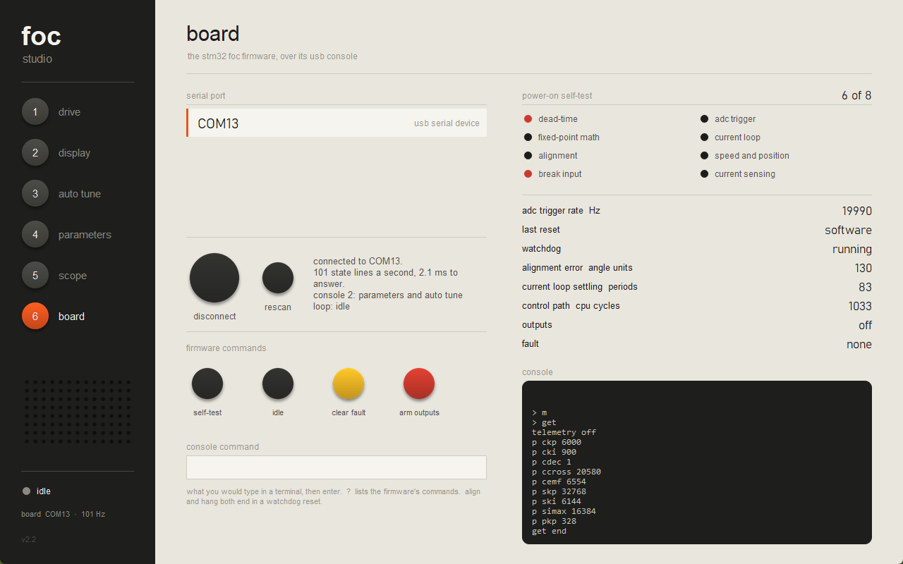
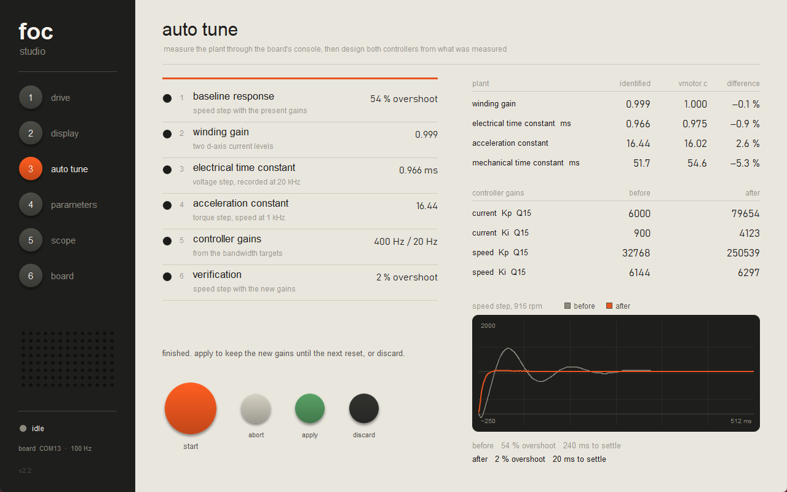
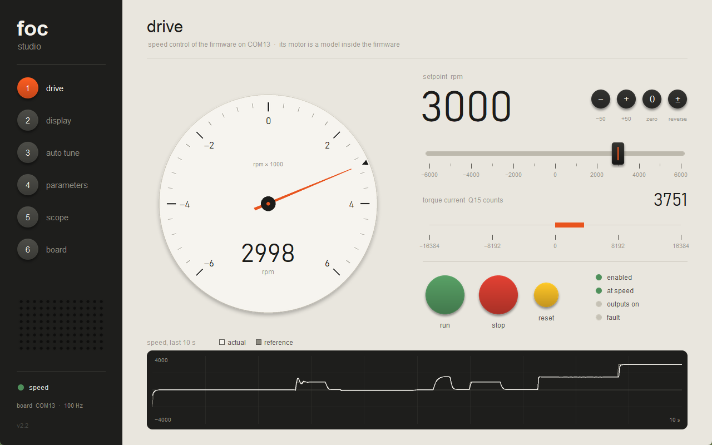
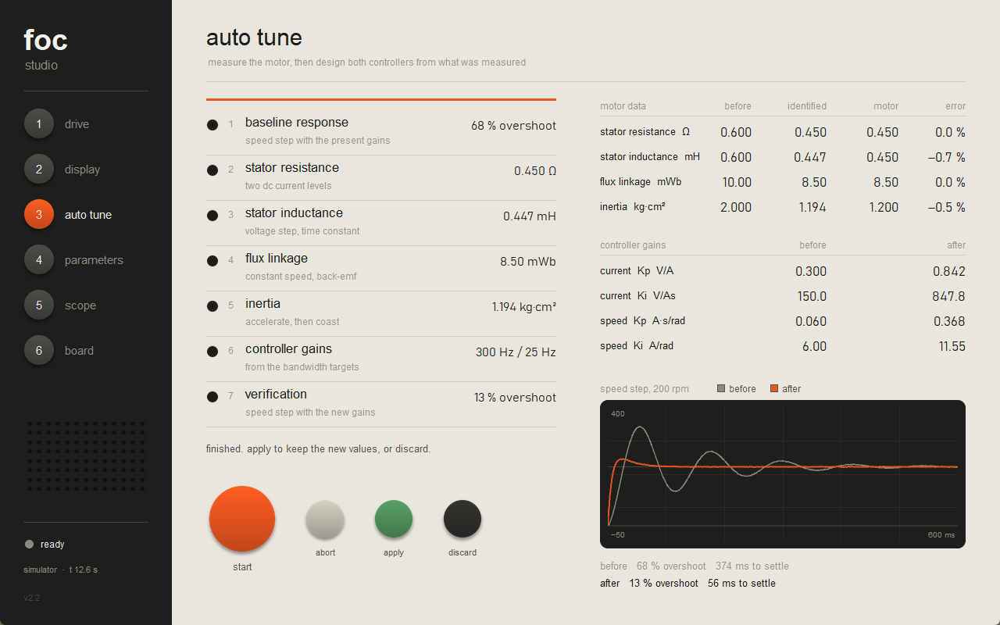
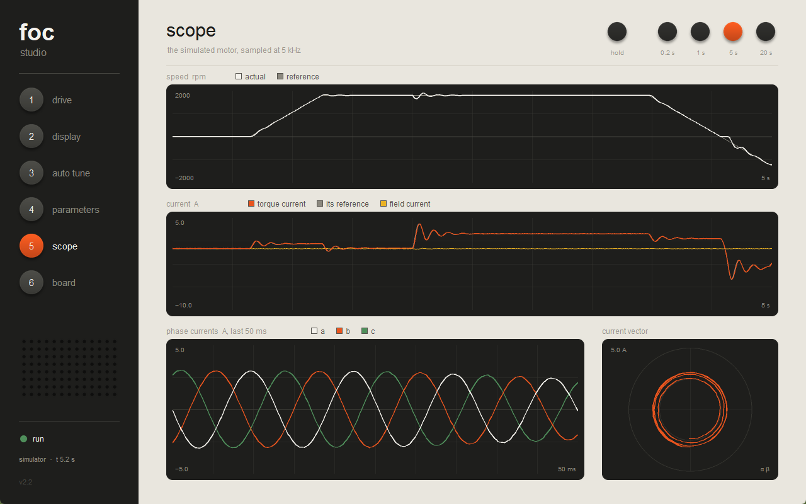
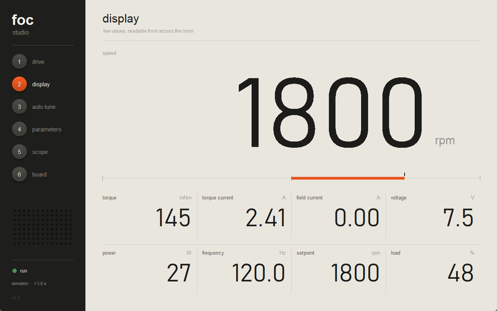
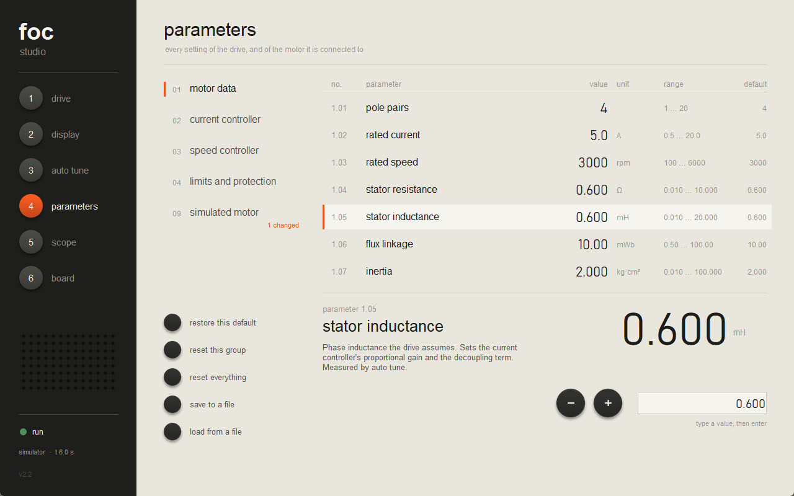

# FOC studio

A drive front end for a permanent-magnet motor. It runs against either of
two things:

- the **simulated motor** built into it (`focsim.py`) - no board needed, and
  what every page shows until you connect;
- the **STM32FOC firmware** on a board, over its USB console (`boardlink.py`).

ภาษาไทย: [README.th.md](README.th.md)


## Pages (keys 1 to 6)

| | page | simulator | board |
| --- | --- | --- | --- |
| 1 | **drive** | speed slider, load slider, run / stop / reset, dial, last 10 s | slider sends `spd`, stop sends `off`, reset sends `clear`; torque current in place of the load slider |
| 2 | **display** | speed in 250 px numerals, torque, currents, voltage, power, frequency | speed, currents in counts, angle, outputs, self-test score |
| 3 | **auto tune** | measures R, L, flux and inertia, designs both controllers | measures the winding and the mechanics through the console, sets the four gains |
| 4 | **parameters** | 29 numbered parameters in five groups, save and load | the nine gains in the firmware, plus the two bandwidths auto tune aims for |
| 5 | **scope** | speed, torque current, phase currents, current vector, at 5 kHz | speed and d/q currents at 100 Hz |
| 6 | **board** | - | port list, connect, self-test result, firmware commands, console |

Auto tune and parameters work on the board when its firmware has console
version 2. With the original console they stay with the simulator and say so.

Space starts and stops. The slider takes clicks, drags, the mouse wheel and
the arrow keys.

## Run it

```
dist\FOC.exe                     the window (after build-exe.cmd)
python foc.py                    the same, from source - needs Pillow
python foc.py --emulator         adds a port called "emulator": the firmware's
                                 arithmetic in Python, for when no board is at hand
python foc.py --selftest out.txt run the simulator's 16 checks, write the result
python foc.py --shots pictures   save a picture of every page
python foc.py --shots pictures --port COM13   ... and of the board pages too
python focsim.py                 the simulator's 16 checks, printed
python fwsim.py                  the emulator's 12 checks, printed
```

`build-exe.cmd` makes `dist\FOC.exe` with PyInstaller: one file, about
15 MB, no Python needed on the machine that runs it.

## With the board



Plug in a board running the STM32FOC firmware, open page 6, pick the port,
press connect. Drive, display and scope switch to the board; the simulator
stands still until you disconnect. Only one program can hold the port, so
close `foc-monitor` first.


How it talks to the firmware:

- It asks for a state line (`s`) 100 times a second, and with console 2 an
  `x` line (applied voltage, loop modes, recorder state) every fifth time.
  One request is in flight at a time. On the board a reply takes about 2 ms.
- **Speed** is the firmware's angle units per ms converted to rpm, which is
  exact (65536 units per turn, one pole pair, as the firmware assumes). The
  slider covers +-6000 rpm, the firmware's own limit.
- **Currents and voltages** stay in Q15 counts. The firmware has no shunt
  gain and no zero-current offset yet, so there is no honest conversion.
- Dragging the slider sends at most ten `spd` commands a second, because
  each one restarts the firmware's speed integrator.
- Connecting sends nothing that moves anything. Disconnecting sends `off`
  only if this session started the loop; otherwise the board is left as it
  was found.
- The motor on the board is still a model, the one inside the firmware
  (`vmotor.c`). There is no gate driver and no real motor yet.

### Parameters and auto tune on the board



The parameters page edits the gains in the firmware's memory with `set`, and
shows what the board says it stored. They are in RAM: **a reset puts the
built-in values back.** The firmware has nowhere to store them yet.

Auto tune (`boardtune.py`) needs nothing the board does not report, and
reads nothing from `vmotor.c`:

| step | how | result on the board |
| --- | --- | --- |
| baseline | 1000 units/ms speed step, recorded on the board | 38 to 54 % overshoot |
| winding gain | two d-axis currents held by the current loop; change in current over change in voltage | 0.998 |
| electrical time constant | a voltage step on the d axis with no controller, recorded at 20 kHz | 0.964 ms |
| acceleration constant | a torque-current step, speed recorded at 1 kHz | 16.43 |
| gains | current PI: Kp = tau wc / gain, Ki = wc / gain. speed PI: Kp = ws / accel, Ki = Kp ws / 5 | ckp 79564, cki 4126, skp 250581, ski 6298 |
| verify | the same speed step again | 2 % overshoot, 20 ms to settle |

Everything on the d axis makes no torque, so the rotor stays put for the
first three; only the last two turn it. The page shows each result beside
what `vmotor.c`'s constants work out to; on the board they agree within 6 %.
On the drive page a step to 1500 rpm peaked at 2161 rpm before and 1538 rpm
after. The baseline varies from run to run because the firmware keeps the
current controllers' integrators across an idle spell.



The simulator's gains still do not transfer to the firmware as numbers: one
works in volts and amps at 10 kHz, the other in Q15 counts at 20 kHz.

### What was found in the firmware on the way

Against the board on COM13, 2026-11-10. The first four are fixed in the
firmware as of console version 2; the host still copes with a board that
has the original.

1. **`spd` was stale outside speed and position mode** - fixed. The host
   works the speed out from `ang` on an original-console board. Checked in
   current mode: `iq 800` showed 637 rpm, 625 by hand from the model.
2. **A completed USB transfer could be lost, and the port died** - fixed.
   Sending `s` and `x` back to back hung the original driver in three
   seconds.
3. **A 64-byte reply arrived one request late** - fixed.
4. **`pi_step()` could overflow with large gains** - never reachable before,
   because the gains were constants. Now the error is clipped where the
   output saturates anyway, in 32 bits; a 64-bit multiply cost a hundred
   cycles per period and failed the loop's own timing test.
5. **`iqref` is stale in idle** - not changed. Shown as zero in idle.
6. **`align` resets the board** - not changed. It blocks for 300 ms inside
   `delay_ms()`, which does not refresh the 100 ms watchdog. There is no
   align button here. `foc-monitor --check` passes its align check anyway,
   because it only looks for the word "align" in the reply.
7. **The motor model never quite stops in idle** - not changed. Its integer
   friction term rounds to nothing at low speed; it creeps at 18 to 40 rpm.

## The simulator

- **Motor:** dq model with cross-coupling and back-EMF, viscous friction, and
  a load that acts as a brake (it opposes motion and cannot drive the shaft).
- **Drive:** 10 kHz current loop (PI on d and q, decoupling, voltage limit,
  anti-windup), 1 kHz speed loop (PI, acceleration and deceleration ramps,
  current limit), over-current and over-speed trips.
- **Sensors:** current noise and a little speed noise.

The drive never reads the motor's real constants. Group 1 holds what the
drive *believes* (a deliberately wrong nameplate guess to begin with) and
group 9 holds the real motor. Auto tune closes the gap by measurement, using
only what a real drive has: its current sensors, its speed feedback and its
own output voltage. Change the motor in group 9, run auto tune again, and it
finds the new values.

Out of the box the speed loop overshoots a 200 rpm step by 68 %. After auto
tune it overshoots by about 14 % and settles in 55 ms instead of 370 ms.
Identification lands within 1 % of the real motor on all four quantities.






## Files

| file | role |
| --- | --- |
| `foc.py` | the window and its six pages |
| `focsim.py` | simulated motor, drive, auto tune, and its self-check - no UI |
| `boardlink.py` | serial port, the 100 Hz polling thread, the firmware's line formats - no UI |
| `boardtune.py` | auto tune for the board, in the firmware's units - no UI |
| `fwsim.py` | the firmware's control arithmetic and console in Python: a stand-in for a board, and its self-check |
| `braun.py` | drawing kit: round buttons, sliders, dial, dark screens, all anti-aliased with Pillow |
| `build-exe.cmd` | builds `dist\FOC.exe` |
| `checks/` | bench checks against a real board, as plain text for a log: `usb_overlap.py` and `usb_fullpacket.py` (the two USB defects), `usb_state.py` (the endpoint register over SWD, without halting), `board_tune.py` (auto tune without the window), `align_reset.py` (shows `align` resetting the board - it does reset it) |

`fwsim.py` is a test double, not evidence. On the same voltage step its
256 recorded samples differ from the board's by at most 2 counts; on a speed
step the board overshoots more (48 % against 38 %), because the emulator
leaves out the sine table and SVPWM.
