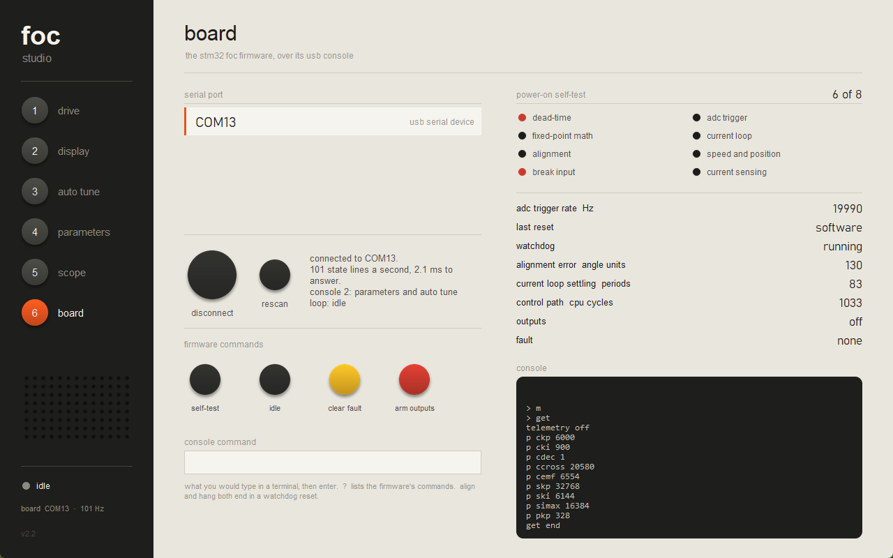
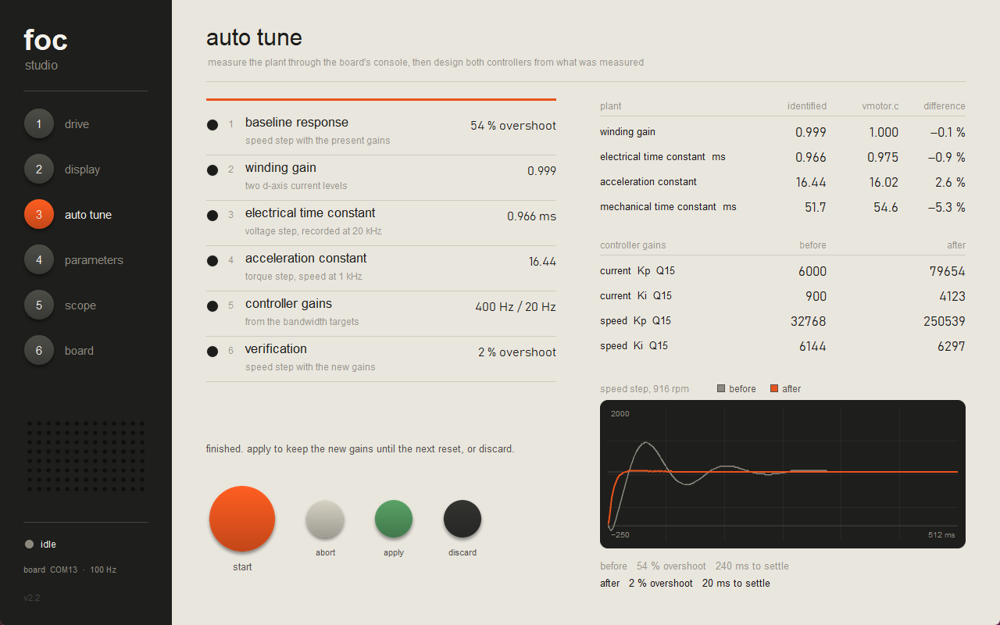
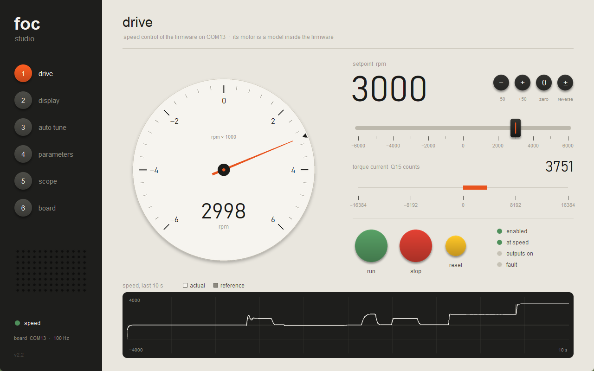
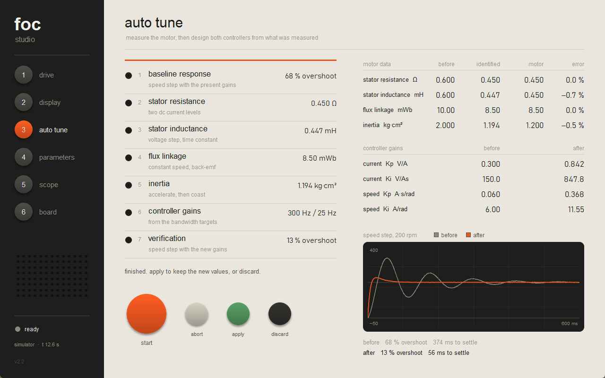
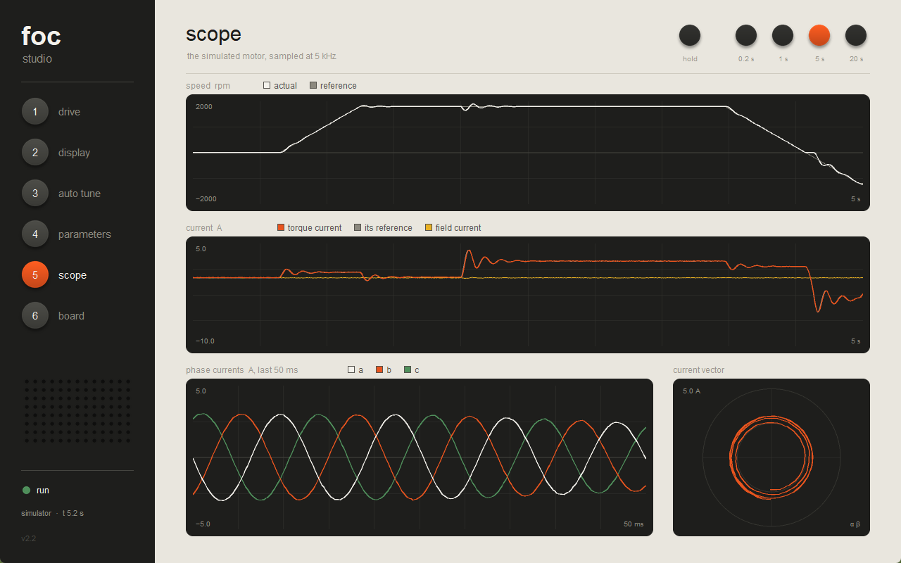

# FOC studio (ภาษาไทย)

โปรแกรมหน้าจอควบคุม drive สำหรับมอเตอร์แม่เหล็กถาวร ใช้งานได้กับ 2 อย่าง:

- **มอเตอร์จำลอง**ที่อยู่ในโปรแกรมเอง (`focsim.py`) ไม่ต้องมีบอร์ด
  ทุกหน้าจะแสดงข้อมูลจากตัวจำลองจนกว่าจะกดเชื่อมต่อ
- **Firmware STM32FOC** บนบอร์ดจริง ผ่าน USB console (`boardlink.py`)

English: [README.md](README.md)


## หน้าต่าง ๆ (กดปุ่ม 1 ถึง 6)

| | หน้า | ตัวจำลอง | บอร์ด |
| --- | --- | --- | --- |
| 1 | **drive** | slider ความเร็ว, slider โหลด, run / stop / reset, หน้าปัดเข็ม, กราฟ 10 วินาที | slider ส่ง `spd`, stop ส่ง `off`, reset ส่ง `clear` และแสดงกระแสแรงบิดแทน slider โหลด |
| 2 | **display** | ความเร็วตัวเลขสูง 250 px, แรงบิด, กระแส, แรงดัน, กำลัง, ความถี่ | ความเร็ว, กระแสเป็น counts, มุม, สถานะ output, คะแนน self-test |
| 3 | **auto tune** | วัด R, L, flux, inertia แล้วออกแบบ controller ทั้งสองลูป | วัดขดลวดและระบบกลผ่าน console แล้วตั้งค่า gain ทั้งสี่ |
| 4 | **parameters** | พารามิเตอร์ 29 ตัว 5 กลุ่ม บันทึกและโหลดได้ | gain 9 ตัวใน firmware และ bandwidth 2 ค่าที่ auto tune ใช้เป็นเป้า |
| 5 | **scope** | ความเร็ว, กระแสแรงบิด, กระแส 3 เฟส, เวกเตอร์กระแส ที่ 5 kHz | ความเร็วและกระแส d/q ที่ 100 Hz |
| 6 | **board** | - | เลือกพอร์ต, เชื่อมต่อ, ผล self-test, คำสั่ง firmware, console |

หน้า auto tune และ parameters ใช้กับบอร์ดได้เมื่อ firmware เป็น console รุ่น 2
ถ้าเป็น console รุ่นแรก สองหน้านี้จะทำงานกับตัวจำลองและแจ้งเหตุผลบนหน้าจอ

กด space เพื่อ run และ stop ส่วน slider ใช้ได้ทั้งคลิก ลาก ล้อเมาส์ และปุ่มลูกศร

## วิธีใช้

```
dist\FOC.exe                     เปิดโปรแกรม (หลังรัน build-exe.cmd)
python foc.py                    เปิดจาก source ต้องมี Pillow
python foc.py --emulator         เพิ่มพอร์ตชื่อ "emulator" คือการคำนวณของ firmware
                                 ที่เขียนด้วย Python ใช้ลองเมื่อไม่มีบอร์ด
python foc.py --selftest out.txt รันการตรวจสอบตัวจำลอง 16 ข้อ แล้วเขียนผลลงไฟล์
python foc.py --shots pictures   บันทึกภาพทุกหน้า
python foc.py --shots pictures --port COM13   บันทึกภาพหน้าที่ต่อกับบอร์ดด้วย
python focsim.py                 การตรวจสอบตัวจำลอง 16 ข้อ
python fwsim.py                  การตรวจสอบตัวเลียนแบบ firmware 12 ข้อ
```

`build-exe.cmd` สร้าง `dist\FOC.exe` ด้วย PyInstaller เป็นไฟล์เดียวขนาดราว 15 MB
เครื่องที่ใช้รันไม่ต้องมี Python

## ใช้กับบอร์ด



เสียบบอร์ดที่มี firmware STM32FOC เปิดหน้า 6 เลือกพอร์ต แล้วกด connect
หน้า drive, display และ scope จะเปลี่ยนไปแสดงข้อมูลจากบอร์ด
ส่วนตัวจำลองจะหยุดนิ่งจนกว่าจะกด disconnect
พอร์ตเปิดได้ทีละโปรแกรม จึงต้องปิด `foc-monitor` ก่อน

วิธีที่โปรแกรมคุยกับ firmware:

- ถามสถานะ (`s`) วินาทีละ 100 ครั้ง และถ้าเป็น console รุ่น 2 จะถาม `x`
  (แรงดันที่จ่าย, โหมดของลูป, สถานะตัวบันทึก) ทุกครั้งที่ห้า
  ส่งทีละคำขอ รอคำตอบก่อนจึงส่งคำขอถัดไป บนบอร์ดจริงแต่ละครั้งใช้เวลาราว 2 ms
- **ความเร็ว** แปลงจากหน่วยมุมต่อมิลลิวินาทีของ firmware เป็น rpm ได้ตรงตัว
  slider ครอบคลุม ±6000 rpm ตามขีดจำกัดของ firmware
- **กระแสและแรงดัน** แสดงเป็นค่า Q15 counts เพราะ firmware ยังไม่มีค่า gain ของ shunt
  และค่า offset ที่กระแสศูนย์ จึงยังแปลงเป็นแอมป์อย่างถูกต้องไม่ได้
- ขณะลาก slider โปรแกรมส่งคำสั่ง `spd` ไม่เกิน 10 ครั้งต่อวินาที
- การกด connect ไม่ส่งคำสั่งที่ทำให้อะไรเคลื่อนไหว ส่วนการ disconnect จะส่ง `off`
  เฉพาะเมื่อโปรแกรมนี้เป็นผู้สั่งให้ลูปทำงาน
- มอเตอร์บนบอร์ดยังเป็นโมเดลที่อยู่ใน firmware (`vmotor.c`)
  ยังไม่มี gate driver และยังไม่มีมอเตอร์จริง

### Parameters และ auto tune บนบอร์ด



หน้า parameters แก้ค่า gain ในหน่วยความจำของ firmware ด้วยคำสั่ง `set`
และแสดงค่าที่บอร์ดตอบกลับว่าเก็บไว้จริง ค่าเหล่านี้อยู่ใน RAM
**เมื่อรีเซ็ตบอร์ด ค่าจะกลับเป็นค่าที่ build มา** เพราะ firmware ยังไม่มีที่เก็บถาวร

Auto tune (`boardtune.py`) ใช้เฉพาะสิ่งที่บอร์ดรายงาน และไม่ได้อ่านค่าจาก `vmotor.c`:

| ขั้น | วิธี | ผลบนบอร์ด |
| --- | --- | --- |
| baseline | สั่งเปลี่ยนความเร็ว 1000 units/ms แล้วบันทึกบนบอร์ด | overshoot 38 ถึง 54 % |
| winding gain | คุมกระแสแกน d สองระดับ แล้วหารส่วนต่างกระแสด้วยส่วนต่างแรงดัน | 0.998 |
| electrical time constant | จ่ายแรงดันแกน d แบบ step โดยไม่ผ่าน controller บันทึกที่ 20 kHz | 0.964 ms |
| acceleration constant | จ่ายกระแสแรงบิดแบบ step บันทึกความเร็วที่ 1 kHz | 16.43 |
| gains | PI กระแส: Kp = tau wc / gain, Ki = wc / gain และ PI ความเร็ว: Kp = ws / accel, Ki = Kp ws / 5 | ckp 79564, cki 4126, skp 250581, ski 6298 |
| verify | สั่งเปลี่ยนความเร็วแบบเดิมอีกครั้ง | overshoot 2 %, เข้าที่ใน 20 ms |

กระแสแกน d ไม่สร้างแรงบิด โรเตอร์จึงอยู่กับที่ในสามขั้นแรก และหมุนเฉพาะสองขั้นหลัง
หน้าจอแสดงค่าที่วัดได้เทียบกับค่าที่คำนวณจากค่าคงที่ใน `vmotor.c` บนบอร์ดต่างกันไม่เกิน 6 %
ในหน้า drive การสั่ง 1500 rpm พุ่งถึง 2161 rpm ก่อนจูน และ 1538 rpm หลังจูน
ค่า baseline ต่างกันในแต่ละรอบ เพราะ firmware เก็บค่า integrator ของลูปกระแสไว้ข้ามช่วง idle



ค่า gain ของตัวจำลองยังนำไปใส่ firmware ตรง ๆ ไม่ได้
เพราะฝั่งหนึ่งคิดเป็นโวลต์และแอมป์ที่ 10 kHz อีกฝั่งเป็น Q15 counts ที่ 20 kHz

### สิ่งที่พบใน firmware ระหว่างทาง

ทดสอบกับบอร์ดจริงบน COM13 เมื่อ 10 พ.ย. 2026 สี่ข้อแรกแก้ใน firmware แล้ว
(console รุ่น 2) ส่วนโปรแกรมฝั่ง PC ยังรับมือกับบอร์ดที่เป็น firmware เดิมได้

1. **ค่า `spd` ค้างเมื่อไม่ได้อยู่ในโหมดความเร็วหรือตำแหน่ง** แก้แล้ว
   กับบอร์ด console รุ่นแรก โปรแกรมจะคำนวณความเร็วจาก `ang` เอง
2. **การรับส่ง USB ที่เสร็จพร้อมกันอาจหายไป แล้วพอร์ตค้างถาวร** แก้แล้ว
   การส่ง `s` กับ `x` ติดกันทำให้ไดรเวอร์เดิมค้างภายในสามวินาที
3. **คำตอบที่ยาว 64 ไบต์พอดีมาช้าไปหนึ่งคำขอ** แก้แล้ว
4. **`pi_step()` ล้นได้เมื่อ gain สูง** เดิมไม่มีทางเกิดเพราะ gain เป็นค่าคงที่
   ตอนนี้จำกัดค่า error ณ จุดที่ output อิ่มตัวอยู่แล้ว โดยยังใช้เลข 32 บิต
   การคูณ 64 บิตกินเวลาเพิ่มราวร้อยรอบ CPU ต่อคาบ จนไม่ผ่านการทดสอบเวลาของลูปเอง
5. **ค่า `iqref` ค้างในโหมด idle** ยังไม่ได้แก้ โปรแกรมแสดงเป็นศูนย์ในโหมด idle
6. **คำสั่ง `align` ทำให้บอร์ดรีเซ็ต** ยังไม่ได้แก้ คำสั่งนี้ค้างอยู่ใน `delay_ms()` 300 ms
   ซึ่งไม่ได้รีเฟรช watchdog ที่ตั้งไว้ 100 ms โปรแกรมนี้จึงไม่มีปุ่ม align
7. **โมเดลมอเตอร์ไม่เคยหยุดสนิทในโหมด idle** ยังไม่ได้แก้ ค่อย ๆ หมุนอยู่ที่ 18 ถึง 40 rpm

## ตัวจำลอง

- **มอเตอร์:** โมเดล dq มี cross-coupling และ back-EMF แรงเสียดทานแบบ viscous
  และโหลดที่ทำตัวเป็นเบรก (ต้านการหมุนได้ แต่ขับเพลาเองไม่ได้)
- **Drive:** ลูปกระแส 10 kHz (PI แกน d และ q, decoupling, จำกัดแรงดัน, anti-windup)
  ลูปความเร็ว 1 kHz (PI, ramp เร่งและหน่วง, จำกัดกระแส) และการตัดเมื่อกระแสเกินหรือความเร็วเกิน
- **เซนเซอร์:** สัญญาณรบกวนที่กระแส และที่ความเร็วเล็กน้อย

Drive ไม่เคยอ่านค่าจริงของมอเตอร์ กลุ่ม 1 คือค่าที่ drive **เชื่อ**
(ตั้งต้นให้ผิดไว้โดยเจตนา เหมือนค่าจาก nameplate ที่ไม่ตรง) ส่วนกลุ่ม 9 คือมอเตอร์ตัวจริง
Auto tune ทำให้สองชุดนี้ตรงกันด้วยการวัด ลองแก้มอเตอร์ในกลุ่ม 9 แล้วรัน auto tune อีกครั้ง
โปรแกรมจะหาค่าใหม่ให้เอง

ค่าตั้งต้นทำให้ลูปความเร็ว overshoot 68 % เมื่อสั่งเปลี่ยนความเร็ว 200 rpm
หลัง auto tune เหลือราว 14 % และเข้าที่ใน 55 ms จากเดิม 370 ms
ค่าที่วัดได้ทั้งสี่ตัวคลาดจากมอเตอร์จริงไม่เกิน 1 %




## ไฟล์

| ไฟล์ | หน้าที่ |
| --- | --- |
| `foc.py` | หน้าต่างและทั้ง 6 หน้า |
| `focsim.py` | มอเตอร์จำลอง, drive, auto tune และ self-check ไม่มี UI |
| `boardlink.py` | พอร์ตอนุกรม, thread ที่ถามบอร์ด 100 Hz และรูปแบบบรรทัดของ firmware ไม่มี UI |
| `boardtune.py` | auto tune สำหรับบอร์ด คิดในหน่วยของ firmware ไม่มี UI |
| `fwsim.py` | การคำนวณและ console ของ firmware เขียนด้วย Python ใช้แทนบอร์ดเวลาทดสอบ |
| `braun.py` | ชุดวาดภาพ: ปุ่มกลม, slider, หน้าปัด, จอมืด ทั้งหมด anti-alias ด้วย Pillow |
| `build-exe.cmd` | สร้าง `dist\FOC.exe` |

`fwsim.py` เป็นตัวแทนสำหรับทดสอบ ไม่ใช่หลักฐาน เมื่อจ่ายแรงดัน step เดียวกัน
ค่าที่บันทึกได้ 256 จุดต่างจากบอร์ดจริงไม่เกิน 2 counts แต่เมื่อสั่งเปลี่ยนความเร็ว
บอร์ดจริง overshoot มากกว่า (48 % เทียบกับ 38 %) เพราะตัวเลียนแบบไม่ได้รวมตารางไซน์และ SVPWM
